

<h3 align="center"><samp>&gt; Hey There!, I am <b><a href="https://mohamed-islam-showcase.vercel.app">Mohammed Islam</a></b></samp></h3>
 

<samp>「 Software engineer building web, mobile, and AI solutions 」</samp>

<samp>École Nationale Supérieure d’Informatique · ESI</samp>

  
  
  


<a href="https://mohamed-islam-showcase.vercel.app"><b>Website</b></a> &nbsp;|&nbsp; <a href="./docs/pages/PROJECTS.md"><b>Projects</b></a> &nbsp;|&nbsp; <a href="./docs/pages/COLLAB.md"><b>Collaboration</b></a>

<a href="https://mohamed-islam-showcase.vercel.app"></a>

<a href="https://math-agent-demo.vercel.app">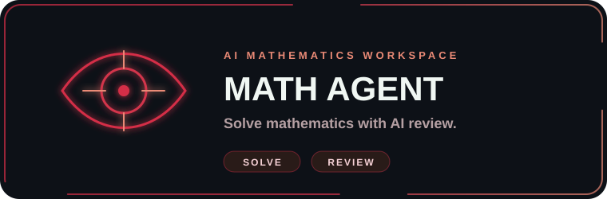</a>
<a href="https://world-between-your-hands.vercel.app">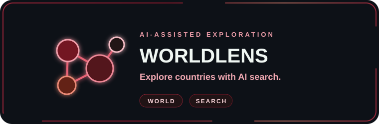</a>
<a href="https://github.com/eng-Islam-Mohamed/The-Impostor">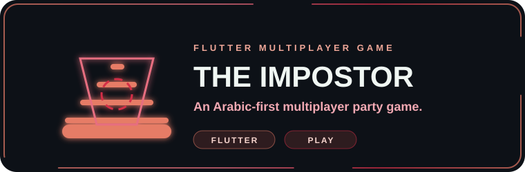</a>

<a href="./docs/pages/PROJECTS.md"></a>


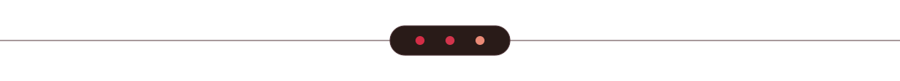

# 🛠 Technologies, Projects, and Domains

<table><tr><td width="420" valign="top" align="center">
<h3>🛠 Technologies</h3>
 
<table align="center" cellpadding="6">
<tr><td></td><td></td><td></td><td></td></tr>
<tr><td></td><td></td><td></td><td></td></tr>
<tr><td></td><td></td><td></td><td></td></tr>
</table>
</td>
<td width="260" valign="top" align="center">
<h3>🧪 Projects</h3> 
<a href="./docs/pages/PROJECTS.md">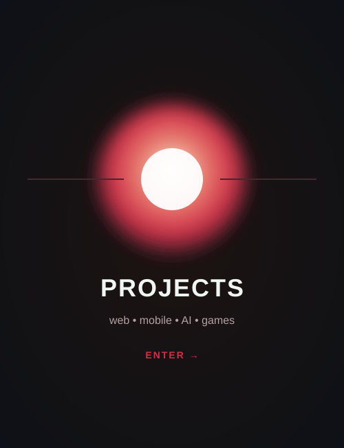</a>
</td>
<td width="260" valign="top" align="center">
<h3>🧠 Focus Areas</h3> 
<a href="./docs/pages/AI_DOMAIN.md">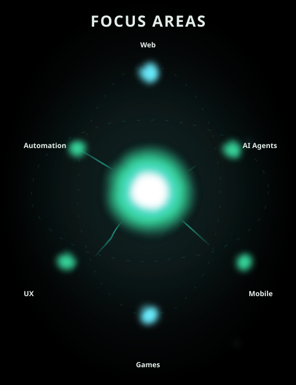</a>
</td></tr></table>

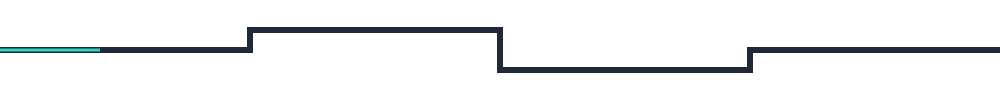

### 📊 Vital Statistics

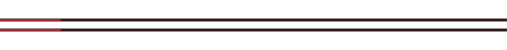

<table width="100%"><tr>
<td width="33%" valign="top">
<h2>🤝 Collaboration</h2>
I’m open to collaborating on:
<ul>
<li>Web applications and useful tools</li>
<li>Flutter and mobile experiences</li>
<li>AI agents and automation</li>
<li>Accessible, multilingual products</li>
</ul>
</td>
<td width="34%" align="center" valign="middle">
<a href="./docs/pages/COLLAB.md">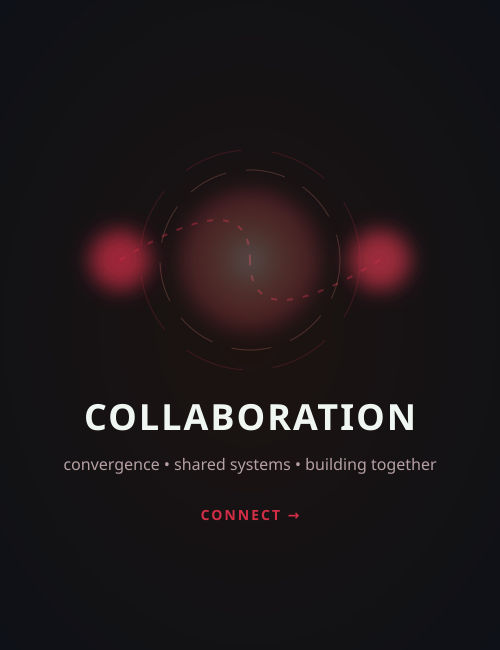</a>
</td>
<td width="33%" valign="top" align="center">
<h2>📫 Contact</h2> 

  

  

</td></tr></table>

⚡ Building modern, scalable, and user-focused applications

<a href="./docs/pages/PROJECTS.md">Projects</a> · <a href="./docs/pages/LABS.md">Labs</a> · <a href="./docs/pages/AI_DOMAIN.md">Focus Areas</a> · <a href="./docs/pages/COLLAB.md">Collaboration</a> · <a href="./CREDITS.md">Design Credits</a>

