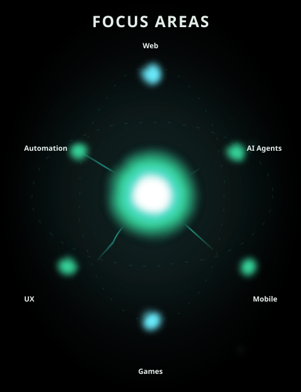

[← Profile](../../README.md) · [Portfolio](https://mohamed-islam-showcase.vercel.app) · [Projects](PROJECTS.md) · [Collaboration](COLLAB.md)

# Focus Areas

- **Web:** modern interfaces and interactive experiences built with TypeScript, JavaScript, and React.
- **Mobile:** cross-platform apps and games with Flutter and Dart.
- **AI:** useful agents, assisted search, and mathematics tools.
- **Games:** multilingual party games and real-time multiplayer.
- **User experience:** accessible interfaces with support for Arabic, French, and English.
- **Automation:** practical tools that make everyday workflows easier.

[See these ideas in my projects →](PROJECTS.md)
