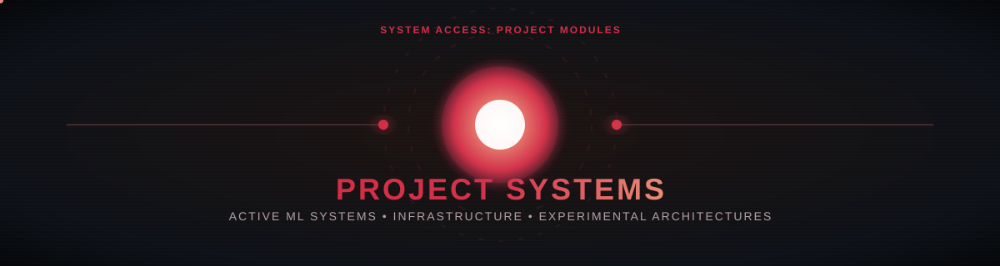

[← Profile](../../README.md) · [Portfolio](https://mohamed-islam-showcase.vercel.app) · [Projects](PROJECTS.md) · [Collaboration](COLLAB.md)

Software for web, mobile, AI, and play. These links point to my public repositories and demos.

| Project | What it does | Explore |
| --- | --- | --- |
| **Portfolio** | Interactive 3D showcase of my work in web, mobile, games, and AI. | [Live](https://mohamed-islam-showcase.vercel.app) · [Source](https://github.com/eng-Islam-Mohamed/Portfolio) |
| **Math Agent** | AI-assisted mathematics workspace with an independent answer review. | [Live](https://math-agent-demo.vercel.app) · [Source](https://github.com/eng-Islam-Mohamed/math-agent) |
| **WorldLens** | Explore countries using AI-assisted search. | [Live](https://world-between-your-hands.vercel.app) · [Source](https://github.com/eng-Islam-Mohamed/Worldlens) |
| **The Impostor** | Arabic-first Flutter party game with online multiplayer. | [Source](https://github.com/eng-Islam-Mohamed/The-Impostor) |
| **JISR** | Multilingual presentation of an accessible Android communication app. | [Source](https://github.com/eng-Islam-Mohamed/JISR_Website) |

[Browse all public work →](https://github.com/eng-Islam-Mohamed?tab=repositories)
